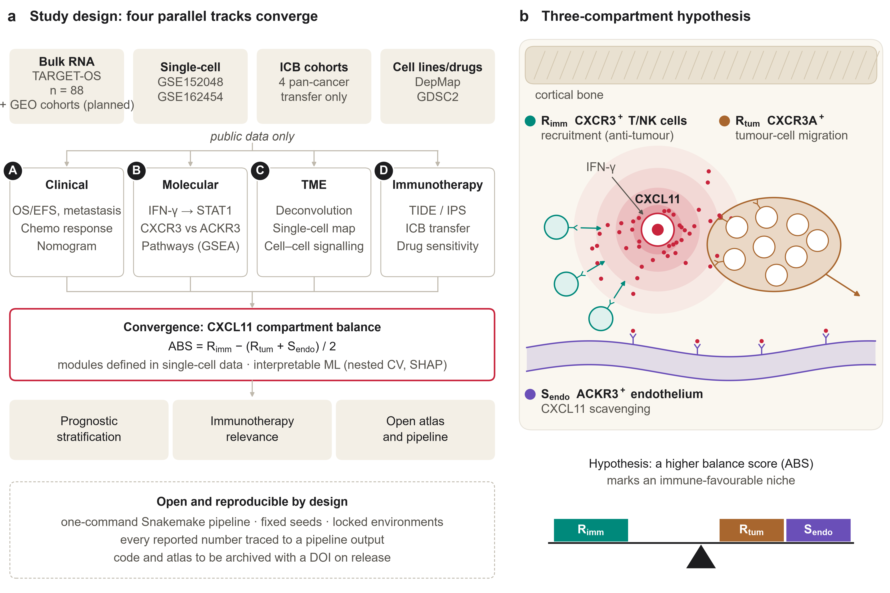

# OS-CXCL11 Atlas

**The CXCL11 – CXCR3 / ACKR3 axis in osteosarcoma: an open, public-data research pipeline with an auditable AI research layer.**

> **Status: research in progress.** This is a working research repository, not a finished study.
> Implemented so far: data acquisition and harmonisation for one cohort (TARGET-OS), an *exploratory*
> single-cohort clinical screen, and the study-design figure. External validation, the single-cell
> compartment map, the modelling tracks and the interactive atlas are planned (see [Roadmap](#roadmap)).
> Nothing here is a validated biological or clinical conclusion, and nothing here is medical advice.



*Figure 1 shows the planned study design and the hypothesis under test; panel b is a hypothesis, not a result.*

## The question

Osteosarcoma has shown little response to PD-1 blockade [1]. CXCL11 recruits effector T and NK cells through
CXCR3, but it is also scavenged by the atypical receptor **ACKR3 (CXCR7)** [2], which has been implicated in
osteosarcoma lung progression [3]; and osteosarcoma cells can themselves use CXCR3 signalling — including the
CXCR3A isoform — for migration and metastasis [4, 5]. This project asks whether these effects separate by
cell compartment, the **three-compartment hypothesis**:

| Compartment | Receptor | Proposed role |
|---|---|---|
| R<sub>imm</sub> — T/NK cells | CXCR3 | recruitment (anti-tumour) |
| R<sub>tum</sub> — tumour cells | CXCR3A | migration (pro-metastatic) |
| S<sub>endo</sub> — endothelium | ACKR3 | CXCL11 scavenging |

The planned balance score is **ABS = R<sub>imm</sub> − (R<sub>tum</sub> + S<sub>endo</sub>) / 2**. Compartment gene
modules *will be* defined in single-cell data and frozen in `config/` before any module score is tested against
an outcome. For transparency: single-gene survival associations of CXCL11 and of the axis genes (CXCL9, CXCL10,
CXCR3, ACKR3) have already been inspected in TARGET-OS as part of the exploratory screen
(`results/tables/gonogo_cxcl11.tsv`, which marks CXCL11 as the pre-specified primary analysis and the other genes as
exploratory with BH q-values). Bulk *CXCR3* mixes immune and tumour sources, and gene-level data cannot by itself
distinguish the CXCR3A isoform; both are known limits of the design.

## What is in this repository

| Layer | Contents |
|---|---|
| **Analysis pipeline** | A Snakemake workflow whose implemented rules run Python scripts (data acquisition, harmonisation, the exploratory screen, figures); parameters and seeds in `config/config.yaml`; locked environments (`uv.lock`, `renv.lock`). R helpers (`R/utils_stats.R`, `style/theme_os.R`) are prepared for later tracks. Runs without any AI tool. |
| **Number integrity** | Statistics used in figures and manuscript text are registered by the script that computed them (`py/stats_registry.py`, `R/utils_stats.R`) into `results/stats.json`; manuscript text uses `{{stat:key}}` placeholders checked by `py/audit_claims.py`. Data cards contain hand-checked descriptive values and say so. |
| **Visual system** | "Marrow" palette checked for colour-vision deficiency, shared by ggplot2 (`style/theme_os.R`) and matplotlib (`py/os_style.py`); journal widths (85/120/180 mm), vector PDF output. |
| **AI research layer** | A bilingual (English/Chinese) project skill and six specialist agents — research steward, bioinformatics analyst, figure artist, manuscript writer, "reviewer 2" and reproducibility auditor — usable with any model or agent tool (`ai/`). |
| **Governance** | A local, evidence-bound gate state machine (seven gates, independent review, invalidation when evidence or configuration changes) and an 11-task research plan (`py/governance.py`, `py/research_plan.py`). No gate has been approved under it yet. |
| **Packaging** | Reproducible builds of the AI layer for the open-source [AIPOCH Open-Science](https://github.com/aipoch/open-science) workbench and for Claude Code, with pre-install verification (`py/build_ai_layer.py`). The AI layer has its own version (`ai/VERSION`), independent of the pipeline version in `pyproject.toml`. |

## Roadmap

| Stage | Status |
|---|---|
| Literature novelty check and hypothesis refinement | historical internal check done; report not public; formal re-review (gate 0) pending |
| TARGET-OS acquisition, harmonisation and data card | done; data-quality review (gate 1) pending |
| Exploratory clinical screen of CXCL11 (one cohort) | done — exploratory only |
| Study-design figure (Fig. 1) | done |
| External validation cohorts (GEO) and the two-cohort Go/No-Go decision | in progress — downloads pending |
| Frozen single-cell compartment modules and atlas | planned |
| Molecular (B) and immunotherapy-transfer (D) tracks | planned |
| Convergence model with nested cross-validation and external validation | planned |
| Interactive atlas | planned |
| Manuscript | planned |

`uv run python py/research_plan.py --root .` prints the task plan; `uv run python py/governance.py --root . status --json`
prints the gate state.

## Getting started

Requirements: Python 3.11–3.13 with [uv](https://github.com/astral-sh/uv). R 4.6 (renv.lock pins 4.6.1, plus Rtools on
Windows) is only needed for the R helpers of later tracks.

```bash
uv sync                                       # Python environment
uv run pytest tests -q                        # engineering tests
uv run snakemake -n --forceall                # show the full DAG of implemented targets
uv run snakemake --cores 8 --forceall         # re-download public data and rebuild every implemented output
Rscript -e "renv::restore()"                  # optional: R environment for later tracks
```

The outputs targeted by the workflow (`results/stats.json`, Fig. 1) are committed, so a plain `snakemake -n` on a
fresh clone reports nothing to do; use `--forceall` to rebuild them from the public sources. Raw and processed data
are never version-controlled.

## Repository layout

```
config/        datasets, parameters, random seeds (single source of truth)
workflow/      Snakemake workflow (Snakefile + rules/)
py/  R/        analysis, data acquisition, figures, integrity, governance and packaging scripts
style/         Marrow visual system (palette.json, ggplot2 theme, matplotlib style)
results/       stats.json, tables and figures produced by the workflow
ai/            AI research layer: skill, specialists, translations, Open-Science setup scripts
docs/          architecture, release notes, data cards
tests/         governance, packaging, research-plan and statistics-integrity tests
```

`docs/private/` (decision log, novelty notes) and `manuscript/` are deliberately not published; the governance and
planning tools report them as missing in a fresh clone.

## Using the AI research layer (optional)

```bash
uv run python py/build_ai_layer.py openscience   # importable skill/specialist packages (English and Chinese)
uv run python py/build_ai_layer.py claude --lang en
```

See [`ai/INSTALL.md`](ai/INSTALL.md) for importing into Open-Science. Models and credentials are configured by each
user inside their own tool; no package in this repository contains credentials.

## Principles

- Pre-specified primary analyses; exploratory results are labelled as such, and negative results are reported.
- No hand-typed statistics in figures or manuscript text, no fabricated data or references, no generative-AI imagery in figures.
- Immune-checkpoint cohorts from other cancers are indirect evidence and are reported as such.
- The governance layer enforces process; it does not authenticate people or establish scientific truth.

## Data sources

All data used so far are public: TARGET-OS (GDC / UCSC Xena). Planned sources are GEO bulk and single-cell cohorts,
public immune-checkpoint-blockade cohorts, TCGA-SARC, DepMap and GDSC; the availability of the spatial dataset is not
yet confirmed. Accessions are listed in `config/config.yaml`. Use of each dataset is subject to its provider's terms.

## References

1. Tawbi HA, et al. Pembrolizumab in advanced soft-tissue sarcoma and bone sarcoma (SARC028). *Lancet Oncol* 2017. PMID 28988646.
2. Naumann U, et al. CXCR7 functions as a scavenger for CXCL12 and CXCL11. *PLoS One* 2010. PMID 20161793.
3. Goguet-Surmenian E, et al. CXCR7-mediated progression of osteosarcoma in the lungs. *Br J Cancer* 2013. PMID 24002596.
4. Pradelli E, et al. Antagonism of chemokine receptor CXCR3 inhibits osteosarcoma metastasis to lungs. *Int J Cancer* 2009. PMID 19544560.
5. Gyau BB, et al. The metastatic role of the CXCL10–CXCR3 axis and its therapeutic potential in osteosarcoma. *J Bone Oncol* 2025. PMID 40502679.

## Licence and disclosure

Code: [MIT](LICENSE). Figures in `results/figures/`: CC BY 4.0, see [LICENSE-figures.md](LICENSE-figures.md).
`renv/activate.R` is generated by renv (MIT, Posit Software, PBC).

This is an independent project. It is not affiliated with or endorsed by AIPOCH or Anthropic; tool names are used only
to describe compatibility. Development was assisted by AI coding agents; all analyses run through the open pipeline above.

## Citation

A manuscript is in preparation; citation details and an archived release DOI will be added here.

---

### 中文简介

本仓库研究骨肉瘤中 CXCL11–CXCR3/ACKR3 轴与免疫治疗的关系。核心是"三区室平衡"假说：T/NK 细胞上的 CXCR3 负责招募免疫细胞，肿瘤细胞上的 CXCR3A 促进迁移，内皮细胞上的 ACKR3 清除 CXCL11。

仓库包含三部分：只用公共数据的可复现分析流水线；保证图表和稿件中每个统计数字都能追溯来源的完整性工具；中英双语的开源 AI 科研层（1 个技能和 6 个专家智能体，可导入 Open-Science 或 Claude Code）。

**研究仍在进行中。**目前完成了单个队列的数据获取、探索性分析和研究设计图；外部验证、单细胞区室图谱、建模和在线图谱尚未完成。本仓库中的任何内容都不是已验证的科学结论，也不构成医疗建议。
