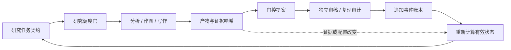

# OS-CXCL11 Atlas 0.4.0 架构

这套系统的目标是把公共数据研究推进到可复核的论文。0.4.0 加强的是研究协作、证据治理和交付工程；研究结论仍取决于真实数据与独立判断。

## 四个职责层

| 层 | 实现 | 保证与边界 |
|---|---|---|
| 计算 | Snakemake、R、Python、参数和环境锁文件 | 已实现目标可脱离 AI 工具运行；规划中的轨道必须另行实现 |
| 协作 | 一个双语项目技能、六类专家、11 项任务契约 | 明确负责人、复核人、产物和验收条件；角色名不等于操作系统权限 |
| 治理 | 标准库 Python 状态机、策略文件、事件账本 | 校验阶段依赖、证据内容、配置版本和独立执行者标识；不能认证真实身份或判断科学真伪 |
| 交付 | 可复现 ZIP、逐文件清单、安装前校验、备份与回退 | 拦截包损坏和路径逃逸；包内校验和不是外部数字签名 |



## 状态与证据

`ai/skills/cxcl11-osteosarcoma-tme/assets/governance-policy.json` 是门控策略，运行器在同一技能的 `scripts/governance.py`。项目的 `py/governance.py` 只是入口，导入的技能包也携带同一运行器。

门控依赖为 `gate0 → gate1 → gate2 → gate3 → {gate4, gate5} → gate6`。提案绑定当前策略、研究配置、证据文件和上游审批。审批需要不同执行者、允许的角色及独立复核报告。证据、配置、策略或所依赖审批变化后，状态必须重新检查，不能沿用旧的绿色标记。

账本位于 `docs/private/governance/events.jsonl`。写入通过独占锁和原子替换完成；事件使用哈希链发现常见篡改和损坏。历史 `decision_log.md` 只作历史背景，必须保留，不会被自动导入。没有外部签名或远端锚定时，掌握整个目录的人可以重写整条链，因此它不是防恶意管理员的安全边界。

策略针对研究阶段执行流程校验；文献新颖性、队列是否真的独立、终点是否正确、统计方法是否适用，仍需复核者检查原始证据。不得把“通过技术验证”写成“证明生物学结论”。

## 任务契约与下一步

`assets/research-plan.json` 保存 11 项具体任务，从验证队列和区室预设到模型、图谱、稿件。每项具有负责人、复核角色、前置门控、实现文件、交付物和验收条件。运行：

```bash
python py/governance.py --root . status --json
python py/research_plan.py --root . --lang zh
```

任务计划只计算是否具备开始工作的前提，并显示缺失实现；不会因为文件存在就宣布任务完成。`ready` 不构成下载、对外发信、部署或发表的新授权。

## 数字的完整性

Python 统计片段和汇总采用严格 JSON、字段校验、重复键检测和原子写入。非法数值、损坏置信区间、错误片段来源等会返回失败。R 产生的既有格式继续兼容。稿件审计识别缺失或损坏的占位符并保留原始行号。

这些检查不会重算统计量，也不会替历史记录补造运行来源。`audit:allow` 等人为例外仍需独立审查；文本扫描不等于完整科学审计。

## 可验证的交付

安装前检查清单、内容大小、哈希和 ZIP 路径，校验失败应在任何安装动作前停止。技能升级先在临时位置准备，再保留旧版本并替换；失败时回退。连接器按显式选择启用，既有项目设置默认保留。随包项目目录排除原始数据、私有记录、稿件、凭据和本地环境。

测试覆盖正常流程和故障注入，包括证据漂移、非法状态跳转、自审、损坏账本、目录越界、异常统计记录和安装失败恢复。离线安装测试使用临时目录，不代表已在全新电脑完成 Open-Science 应用安装，也不代表已完成模型提供商配置。

## 研究现状与扩展原则

当前已有数据获取和预处理、探索性临床分析、研究设计图。B/C/D 轨道、汇合模型、交互图谱仍是待实现任务。现有研究假说和 TARGET-OS 探索性统计不会因为软件版本升级而获得更强证据。

扩展时优先增加真实能力及其验收证据：官方镜像来源核对与下载恢复、冻结区室模块、独立外部验证、可追溯图表。新增角色只有在具有独立职责和明确交接物时才有价值。
